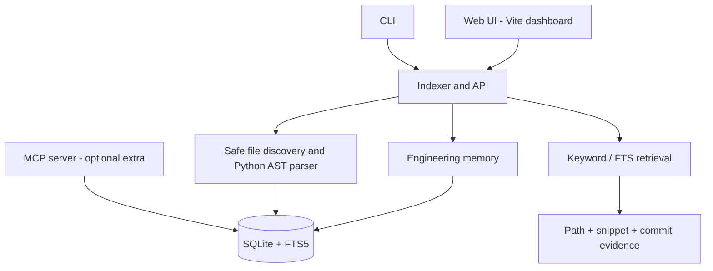

# Architecture

RepoPilot starts as a local-first modular monolith.

## Current implementation

- FastAPI routes and a command-line entry point.
- Bearer-token authentication for `/api/*`, with public liveness and readiness endpoints.
- React/Vite dashboard for local repository registration, full-text search, and evidence retrieval.
- `/ask` evidence citations include a source path, line range, content hash, and indexed commit.
- SQLite persistence, FTS5 full-text search, symbol records, import edges, memory CRUD.
- Python AST symbol extraction and Python import extraction.
- SQLite writes for each index snapshot occur in a transaction; filesystem scanning happens before that transaction, so scans are not globally serialized across separate processes.
- Local API and MCP tool access are read-only with respect to source files.

## Deliberate limits

- Semantic embeddings and reranking are not implemented. Optional OpenAI-compatible generation exists, but citation-path validation is not a proof that every factual clause is supported by its cited snippet.
- Symbol extraction is currently Python-specific.
- The graph records conservative static import/include/use edges for Python, JavaScript/TypeScript, Java/Kotlin, Go, C/C++, Rust, and C#. These edges are heuristic and do not constitute a complete compiler-resolved dependency graph or call graph.
- Indexing is synchronous and intended for local repositories of modest size.
- Multi-user tenancy, background jobs, rate limiting, and patch execution are not implemented.
